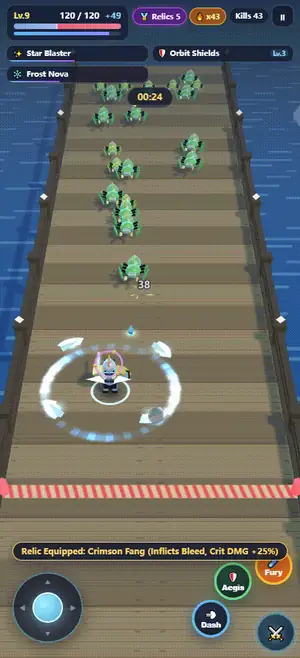
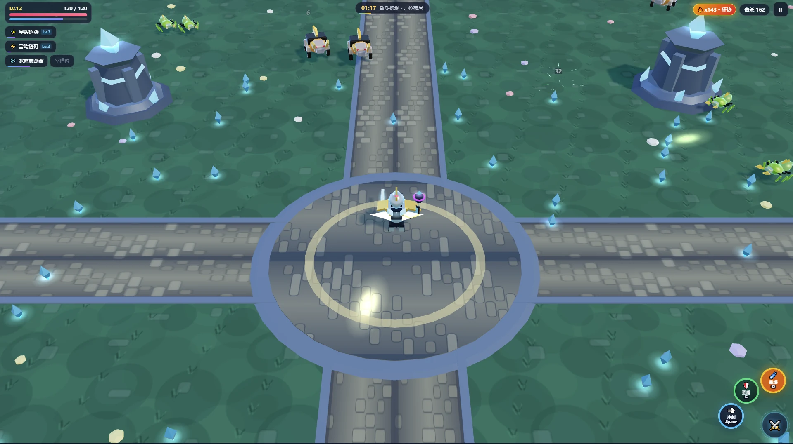
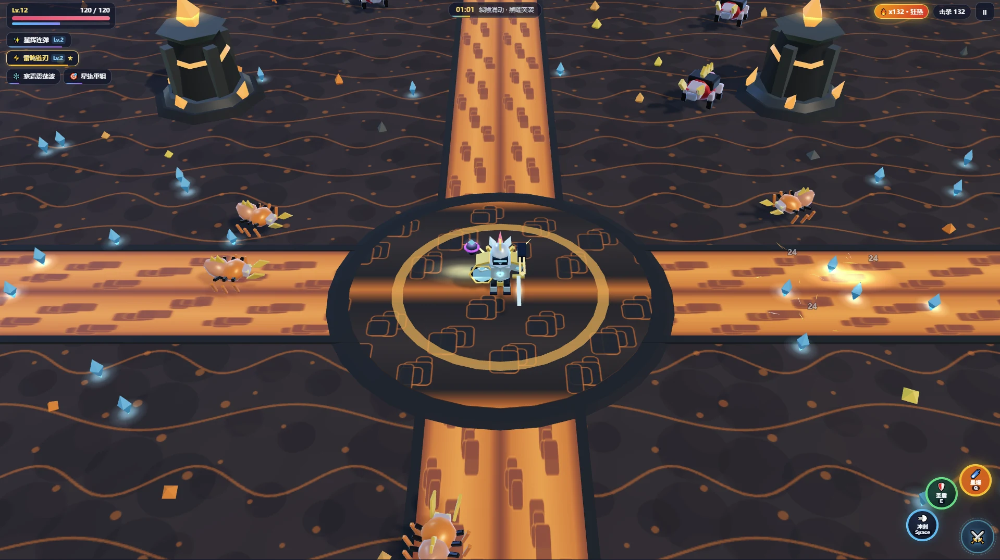

<div align="center">


# Tiny Vanguard

双击即玩的 3D 战甲动作生存与防线守卫（1 MB 单文件离线版）

[](https://vuejs.org)
[](https://threejs.org)
[](https://www.typescriptlang.org)
[](https://vite.dev)

[中文](README.md) · [English](README_en.md)

[开始玩](#开始玩) · [版本沿革](#版本沿革) · [从源码构建](#从源码构建) · [操作](#操作) · [玩法与内容](#玩法与内容) · [目录](#目录) · [提示词与 Skill](#提示词与-skill) · [文档](#文档) · [致谢](#致谢)

</div>

操纵硬甲战甲先锋「星辉先锋」，在 **荒野生存** 与 **通道守卫** 两大核心模式中迎战高密度立体敌潮：一边通过走位、三大主动技（冲刺 / 圣盾 / 星爆）与三选一构筑引爆割草爽感，一边击破增益光栅、净化红框污染门、触发五对「超武共鸣觉醒」并斩杀终局重甲泰坦首领。

项目构建产出是 `tiny-vanguard/dist/` 下的单个自包含 HTML 文件（同步至 `docs/index.html` 用于 GitHub Pages），双击（`file://`）或静态托管即可在浏览器中完全离线运行，零外部脚本、贴图、字体或音频请求。支持桌面端、平板及手机横竖屏与异形屏安全区适配。


## 核心特性

- **两大核心玩法 × 8 大渐进关卡 + 无尽深渊**：
  - **荒野生存（Wild Survival）**：`翠风草甸`、`熔岩峡谷`、`幽影废墟`、`星渊王座`（42° 3D 动作斜视角，最低在场怪数保底 + 阵型事件波 + 限时全息空投补给，第 4 关首领后可进入**无尽深渊**，支持首领击破「巅峰超限突破」无限成长与主动撤离结算）。
  - **通道守卫（Bridge Defense）**：`木桥防线`、`霜雪栈桥`、`钢铁高架`、`深渊断桥`（`4.8m` 可视战术防区 + 双路无框全息光栅射击升阶/红门净化与走位穿过二选一 + 重盾先锋阵列，第 4 关首领后同样支持**无尽深渊**与「巅峰超限突破」）。
- **暗黑式三阶段局外养成闭环（军备库 4 标签页）**：
  - **英雄解锁与升星（1★→5★）**：支持「星辉骑士」「风暴游侠」「钢铁壁垒」3 名英雄，局后结算产出专属碎片与星耀徽记，提升基础生命、伤害与专属特性（老胜利存档自动兼容解锁）。
  - **军备天赋（8 项）**：除 6 项基础属性天赋外，新增「命运骰子」（开局重随次数 +1/级）与「弑王锋芒」（对精英/首领伤害 +8%/级）。
  - **圣物 5 档品质 × 本命配装 × 精炼 × 开孔宝石 × 附魔共鸣**：20 件圣物按白→绿→蓝→紫→橙分级，点亮后可在军备库进行 `+1~+5` 精炼、15⭐ 开孔镶嵌 4 种×3 阶宝石（支持 3 合 1 合成与无损卸下）、12⭐ 附魔洗练（6 词条），并可装配最多 2 件带入开局（双稀有+激活「圣物共鸣」）。选关界面实时展示**战前出征总览条**。
- **5 大核心战技 × 20 遗物 × 超武共鸣觉醒**：
  - 战技：`星辉连弹`（最近/防线优先）、`守护星环`（近身光刃护体）、`寒霜震荡波`（范围减速控制）、`雷鸣链刃`（专劈最密集怪堆质心）、`星轨重狙`（专点高血精英与首领）。
  - 内容规模：**20 种 Debuff**、**22 种通道增益**、**20 件遗物装备**、**34 项升级**，支持 5 对战技×遗物「超武共鸣觉醒」与 25/60/120 连杀狂热（每百斩触发全图磁吸圣爆）。
- **零后处理高燃 GLSL 光效与 3D 战甲重塑**：
  - 采用 **Additive Fake Bloom + 单 Pass GLSL Shader**（激波噪波环、旋转能量光轨、天降星陨全息光柱、动态折线闪电链、穿透激光束、冲刺残影），零重型后处理，稳帧 60 FPS；
  - 三点冷暖布光 + 轻量 Fresnel 轮廓光 + 3.5 头身战甲先锋 + 立体非卡通怪物/重甲泰坦首领 + 静态场景 `InstancedMesh` 合批。
- **组件化动态配乐与音效（BGM + SFX）**：纯 Web Audio 程序化音乐序列器与三总线音频引擎，按主菜单 / 荒野生存 / 通道守卫 / 首领战与连杀狂热以 `82–114 BPM` 稳态变奏，支持暂停页 BGM/SFX 独立开关及主菜单快捷静音。
- **QA 调试控制台**：3 秒内连续按两次 `F9`（或 URL `?debug=1`）可呼出中英双语 QA 调试台，支持实时遥测、`1x/2x/4x` 倍速、无敌、跳关、全战技/全 20 遗物、刷光栅与直达首领战。
- **工业级健壮性与门禁**：代际防重入 `ObjectPool`（支持并发迭代快照）、中心螺旋扩张 `SpatialGrid`、热循环零 GC、`npm run gate` 五道构建前校验 + 59 项 Vitest 单元测试。

## 版本沿革

完整记录见 [CHANGELOG.md](CHANGELOG.md)。

| 版本 | 日期 | 内容 |
| --- | --- | --- |
| 1.0.0（全面重塑） | 2026-11-18 | 升级 2 大核心玩法 4 关分页序列、5 大战技、20 Debuff / 22 Buff / 20 遗物 / 28 升级、Wave Director、双路充能与红门净化光栅（走位穿过二选一）、动态程序化 BGM/SFX、双击 `F9` QA 调试台、全端屏幕适配、`⚔️ 攻击 (J)` + 3 槽宽扇弧技能轮盘（`Space`/`E`/`Q`）、双模式 BOSS 平衡与 `InstancedMesh` 合批优化（单 HTML 约 `1.019 MiB`）。 |
| 1.0.0（初版） | 2026-11-17 | 首次可玩版本。Vue 3 + TypeScript + Three.js 核心架构与单 HTML 离线打包（约 `0.653 MiB`）。 |

## 开始玩

用浏览器打开仓库里的单文件构建产物：

```text
tiny-vanguard/dist/tiny-vanguard-<版本>-<YYYYMMDD-HHmmss>.html
```

也可以直接打开或通过 GitHub Pages 访问已同步的 `docs/index.html`。版本来自 `tiny-vanguard/package.json` 的 `version`，构建时间戳记录在文件头注释及 `<meta>` 标签内，每次构建只保留最新一份。

最佳成绩与画质/BGM/SFX/语言设置保存在 `localStorage` 中；若环境禁止本地存储，自动退回内存会话模式。

## 从源码构建

在 `tiny-vanguard/` 目录执行，需要 Node.js 18 及以上（推荐 Node 22）。Windows PowerShell 5.1 请逐条执行命令：

```powershell
cd tiny-vanguard
npm install
npm run gate
```

| 脚本 | 作用 |
| --- | --- |
| `npm run dev` | 启动 Vite 本地开发服务器 |
| `npm run check` | 运行 5 道构建前门禁（0 循环依赖、安全离线红线、热循环零 GC、内容配额与解耦） |
| `npm run type-check` | 运行 `vue-tsc --noEmit` 严格类型检查 |
| `npm test` | 运行 Vitest 59 项单元测试与无头战斗全流程模拟 |
| `npm run build:single` | 打包带版本号与时间戳的单 HTML（输出至 `dist/` 并同步到 `../docs/index.html`） |
| `npm run verify:single` | 校验最新单 HTML 的零外链、经典脚本兼容性、隔离目录运行及体积 |
| `npm run gate` | 串联执行 `check` → `type-check` → `test` → `build:single` → `verify:single` |

## 操作

| 输入 | 作用 |
| --- | --- |
| `WASD` / 方向键 | 移动（自动索敌与多战技协同攻击） |
| `J` / 右下角「攻击」 | 主动星弹连射爆发（与自动攻击并存） |
| `Space` / 右下角「冲刺」 | 战术冲刺（带短瞬无敌帧与离子残影） |
| `E` / 右下角「圣盾」 | 圣盾护体（获得护盾、短瞬无敌并击退减速周围敌人） |
| `Q` / 右下角「星爆」 | 充能满释放「星爆大招」（天降星陨光柱 + 全屏清场） |
| `1` / `2` / `3` 或点击卡片 | 升级弹窗三选一 |
| 左下角虚拟摇杆（触屏自动显示） | `pointerId` 隔离无极方向移动 |
| 右上角 `⏸` 按钮 | 暂停、画质切换（省电 / 均衡 / 高清）、BGM/SFX 独立开关与中英切换 |
| `F9` × 2（3 秒内双击） | 开关中英双语 QA 调试控制台 |

**移动端触控与弧形技能轮盘实机演示：**

<div align="center">

</div>

## 玩法与内容

### 荒野生存（翠风草甸 / 熔岩峡谷）

4.5～6 分钟四阶段递进割草——前期蓄势发育 → 中期敌潮与阵型事件波 → 后期满屏割草狂欢 + 击杀精英/空投补给直穿遗物 → 终局重甲泰坦首领战。





### 通道守卫（木桥防线 / 霜雪栈桥）

扼守桥尾红线（`4.8m` 青色战术防区），射击充能或净化双路全息光栅（`Lv.1 → Lv.3`，红框污染门净化跃升 `Lv.2`），通过走位穿过实现二选一互斥领奖；击杀直接装配战技与遗物，迎战重盾先锋阵与攻城首领。


## 目录

```text
.
├── pic/                     中英文实机截图与移动端演示
├── prompts/                 本项目完整工程与玩法提示词
├── skills/                  离线 Web 3D 游戏与 Three.js Agent Skills
├── docments/                架构、玩法、内容扩展与验收文档
├── docs/index.html          与最新构建同步的 GitHub Pages 页面副本
├── tiny-vanguard/
│   ├── index.html           开发入口
│   ├── package.json
│   ├── scripts/             门禁校验、单文件后处理与离线纯度审计脚本
│   ├── src/
│   │   ├── assets/          应用图标与界面标志
│   │   ├── components/      Vue 3 HUD、菜单、选关、摇杆与调试台
│   │   ├── config/          应用元配置
│   │   └── game/
│   │       ├── audio/       Web Audio 三总线音效与动态程序化配乐
│   │       ├── config/      画质档位与运行时预算配置
│   │       ├── content/     关卡、战技、遗物、Buff/Debuff、升级与注册校验
│   │       ├── core/        GameRuntime、双时钟 GameClock、状态机与指令事件
│   │       ├── debug/       双击 F9 QA 调试桥
│   │       ├── i18n/        中英双语文案字典
│   │       ├── input/       WASD 与触屏输入缓冲控制器
│   │       ├── pool/        防重入代际快照 ObjectPool
│   │       ├── scene/       Three.js 场景、硬面模型、GLSL 特效与地形缓存
│   │       ├── session/     GameSession、实体数据结构与 localStorage 存档
│   │       ├── spatial/     中心螺旋扫描 SpatialGrid
│   │       ├── systems/     移动、战斗、波次、状态效果、经验与升级系统
│   │       └── __tests__/   41 项 Vitest 单元测试与无头战斗全流程模拟
│   └── dist/                tiny-vanguard-<版本>-<时间>.html
├── CHANGELOG.md
├── LICENSE
├── README.md
└── README_en.md
```

## 提示词与 Skill

`prompts/` 与 `skills/` 各自承担不同职责：

- [tiny-vanguard-3d-horde-action-master-prompt.md](prompts/tiny-vanguard-3d-horde-action-master-prompt.md)：沉淀了《Tiny Vanguard》的双模式玩法、零后处理 GLSL 光效、硬面 3D 建模、动态 Web Audio、多端适配与五道工程门禁规范。
- [skills/game-web3d-standalone-builder/](skills/game-web3d-standalone-builder/SKILL.md)：面向支持 Agent Skills 的编程助手，提供「模块化 TypeScript 源码 + 单文件离线 HTML」的通用构建与验收方法论（附 `SCENARIOS.md` 与 `scripts/audit-standalone-html.mjs`）。
- [skills/three-js/](skills/three-js/SKILL.md)：Three.js 场景、着色器与渲染参考技能。

可在仓库根目录单独执行离线产物审计：

```bash
node skills/game-web3d-standalone-builder/scripts/audit-standalone-html.mjs
```

## 文档

- [架构说明](docments/ARCHITECTURE.md)
- [玩法设计](docments/GAMEPLAY.md)
- [内容扩展指南](docments/EXTENDING.md)
- [构建、验收与 Release 说明](docments/RELEASE_AND_ACCEPTANCE.md)

## 致谢

- [Three.js](https://threejs.org/)
- [Vue 3](https://vuejs.org/)
- [Vite](https://vite.dev/) & [vite-plugin-singlefile](https://github.com/richardtallent/vite-plugin-singlefile)
- [Vitest](https://vitest.dev/)

## 开源协议

[MIT License](LICENSE)
