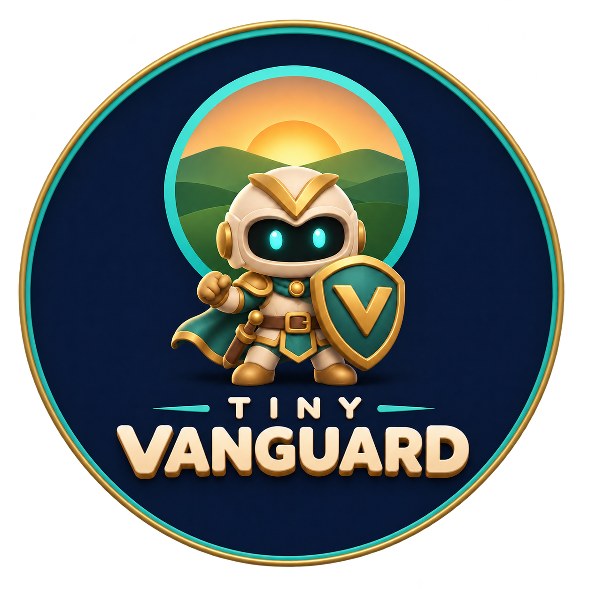
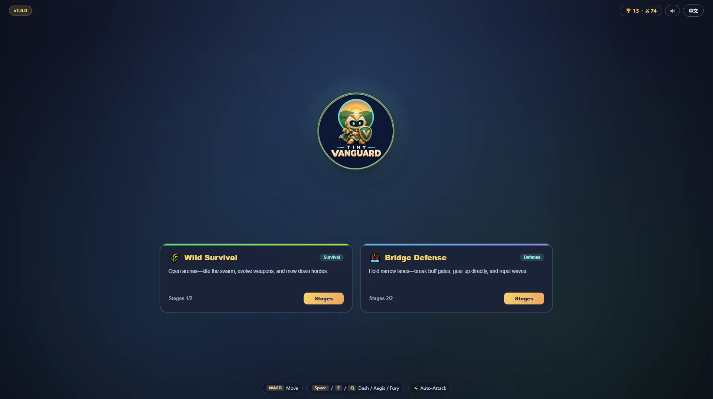
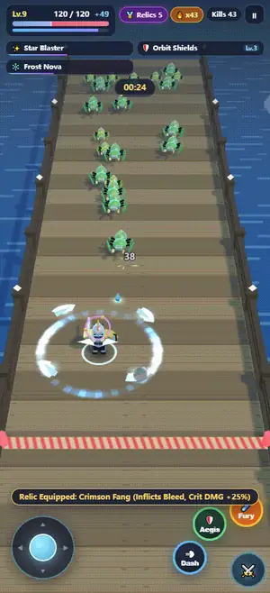
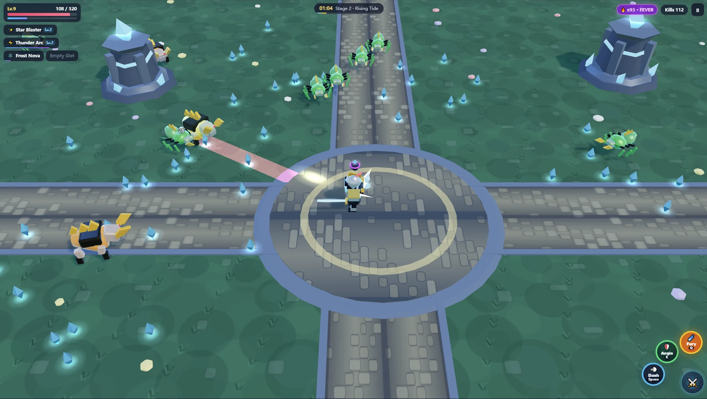
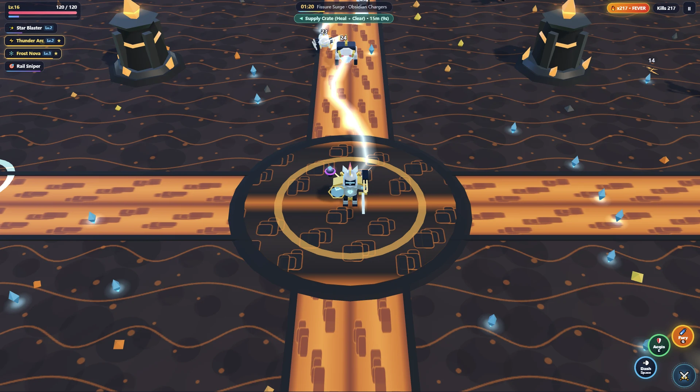
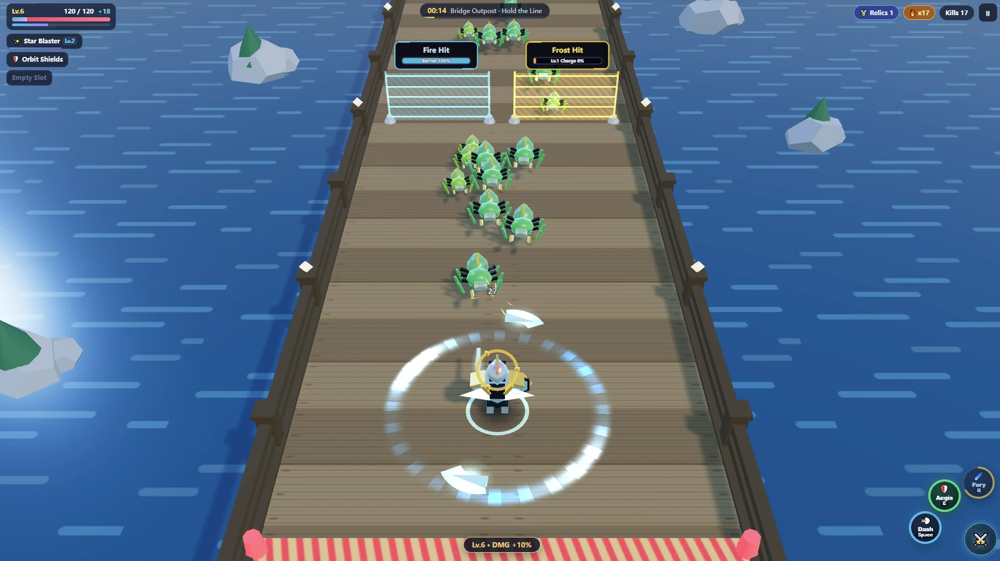
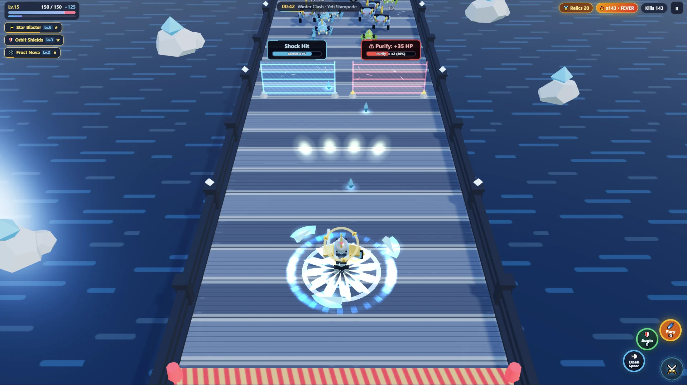

<div align="center">



# Tiny Vanguard

Instant-play offline 3D vanguard survival & lane-defense game in a single ~1 MB HTML.

[](https://vuejs.org)
[](https://threejs.org)
[](https://www.typescriptlang.org)
[](https://vite.dev)

[中文](README.md) · [English](README_en.md)

[Play](#play) · [Versions](#versions) · [Build from source](#build-from-source) · [Controls](#controls) · [Gameplay](#gameplay) · [Docs](#docs)

</div>

Pilot the armored **Star Vanguard** across **Wild Survival** and **Bridge Defense** against escalating 3D enemy hordes. Weave through telegraphed attacks with three active skills (Dash, Aegis Guard, Starfall Fury), stack 20 relics to awaken super-synergies, shoot-to-charge or purify holographic laser gates, and defeat towering armored Titan bosses.

The standalone build outputs a single self-contained HTML file under `tiny-vanguard/dist/` (synced to `docs/index.html` for GitHub Pages) that runs completely offline via `file://` double-click or static hosting with zero external scripts, textures, fonts, or audio requests. Supports desktop, tablet, and portrait/landscape mobile viewports with safe-area adaptation.



## Features

- **Two Core Modes + Paginated Stage Progression**:
  - **Wild Survival**: `Verdant Meadow` & `Ember Canyon` (42° 3D action camera, minimum active-enemy floor Wave Director, ring/stampede/escort formation waves, timed holographic Supply Drop Pods, and Titan boss fights).
  - **Bridge Defense**: `Bridge Defense` & `Frost Bridge` (narrow-lane defense with frameless dual holographic laser gates—break gates, shoot-to-charge tier upgrades, and red corrupted gates you purify by shooting—plus armored Shield Vanguard phalanxes).
- **5 Core Skills × 20 Relics × Super Synergy Awakenings**:
  - Core Skills: `Star Blaster`, `Orbit Shields`, `Frost Nova`, `Thunder Arc` (density-cluster targeting), and `Rail Sniper` (boss/elite/highest-HP targeting).
  - Content: **20 Debuffs**, **22 Lane Buffs**, **20 Equipment Relics**, **28 Upgrades**, 5 skill-relic Super Synergies, and 25/60/120 Combo Fever tiers with 100-kill arena vacuum blasts.
- **Zero-Postprocessing GLSL VFX & 3D Hard-Surface Visuals**:
  - Uses **Additive Fake Bloom + Single-Pass GLSL Shaders** (animated ground shockwaves, rotating orbital rune tracks, sky-beacon/starfall pillars, jagged lightning ribbons, piercing sniper lasers, dash afterimages) with zero heavy postprocessing passes;
  - Three-point warm/cool lighting + Fresnel rim shaders + 3.5-head Armored Vanguard + faceted 3D Rift Stalkers, Ravager Beasts, Void Constructs, War Golems, Shield Vanguards, and Dread Titan Bosses + `InstancedMesh` static scene batching.
- **Dynamic Procedural Music & SFX**: Componentized Web Audio `MusicSequencer` & 3-bus `SoundEngine` that adapt themes and steady `82–114 BPM` grooves across Menu, Wild Survival, Bridge Defense, Boss encounters, and Combo Fever, with independent BGM/SFX toggles.
- **Bilingual QA Debug Console**: Double-press `F9` within 3 seconds (or `?debug=1`) to toggle the live telemetry & QA console (`1x/2x/4x` speed, God Mode, level jump, all skills/20 relics, gate/formation triggers, Boss jump).
- **Automated 5-Gate Verification**: Snapshot-safe `ObjectPool`, center-outward `SpatialGrid`, zero-GC hot loops, `npm run gate` static/quota checks, `vue-tsc`, and 38 Vitest tests.

## Versions

Full history in [CHANGELOG.md](CHANGELOG.md).

| Version | Date | Contents |
| --- | --- | --- |
| 1.0.0 (Overhaul) | 2026-11-18 | Expanded to 2 modes / 4 paginated stages, 5 core skills, 20 Debuffs / 22 Buffs / 20 Relics / 28 Upgrades, Wave Director, shoot-to-charge & red purify laser gates, dynamic procedural BGM/SFX, double-`F9` QA Debug Console, multi-screen adaptation, 3-slot radial skill wheel (`Space`/`E`/`Q`), P0/P1 race & `InstancedMesh` batching fixes, and 3D hard-surface + GLSL VFX overhaul (~`1.017 MiB`). |
| 1.0.0 (Initial) | 2026-11-17 | Initial playable release (~`0.653 MiB`). |

## Play

Open the single-file build in any modern browser:

```text
tiny-vanguard/dist/tiny-vanguard-<version>-<YYYYMMDD-HHmmss>.html
```

`docs/index.html` is kept in sync for GitHub Pages. Records and graphics/BGM/SFX/language settings persist in `localStorage` with automatic in-memory fallback when storage is restricted.

## Build from source

Run inside `tiny-vanguard/` with Node.js 18+ (Node 22 recommended):

```bash
cd tiny-vanguard
npm install
npm run gate
```

| Script | What it does |
| --- | --- |
| `npm run dev` | Start Vite dev server |
| `npm run check` | Run 5 prebuild gates (0 circular imports, security/offline, zero-GC hot loops, content quotas) |
| `npm run type-check` | Run `vue-tsc --noEmit` |
| `npm test` | Run 38 Vitest unit & headless simulation tests |
| `npm run build:single` | Build single-file HTML (`dist/`) and sync to `../docs/index.html` |
| `npm run verify:single` | Verify zero external links, classic script compatibility, isolated copy, and size |
| `npm run gate` | Run `check` → `type-check` → `test` → `build:single` → `verify:single` |

## Controls

| Input | Action |
| --- | --- |
| `WASD` | Move (auto-aim & multi-skill combat) |
| `Space` / Dash button | Tactical Dash (brief i-frames + afterimage trail) |
| `E` / Aegis button | Aegis Guard (grant barrier shield, brief i-frames, knockback & chill) |
| `Q` / Fury button | Starfall Fury Ultimate (vertical celestial pillar + arena blast) |
| `1` / `2` / `3` or click | Select level-up upgrade |
| Bottom-left joystick | Touch movement (`pointerId`-isolated) |
| Top-right `⏸` | Pause, graphics tier, independent BGM/SFX toggles, and ZH/EN switch |
| Double-tap `F9` (within 3s) | Toggle bilingual QA Debug Console |

**Mobile Portrait Touch Joystick & Radial Skill Wheel Demo:**

<div align="center">

</div>

## Gameplay

### Wild Survival (`Verdant Meadow` / `Ember Canyon`)

4.5–6 min 4-stage mowing curve—early buildup → mid-game formation waves (`ring-surround`, `side-stampede`, `elite-escort`) → high-density mowing frenzy + direct relic drops from elites & Supply Drop Pods → final Titan Boss showdown.





### Bridge Defense (`Bridge Defense` / `Frost Bridge`)

Defend the chevron barrier line, break or shoot-to-charge dual holographic laser gates (purifying red corrupted gates jumps straight to Lv.2 ×2), equip relics/skills directly on kills, and break Shield Vanguard phalanxes.





## Docs

- [Architecture](docments/ARCHITECTURE.md)
- [Gameplay Design](docments/GAMEPLAY.md)
- [Extending Content & Systems](docments/EXTENDING.md)
- [Release & Acceptance](docments/RELEASE_AND_ACCEPTANCE.md)
